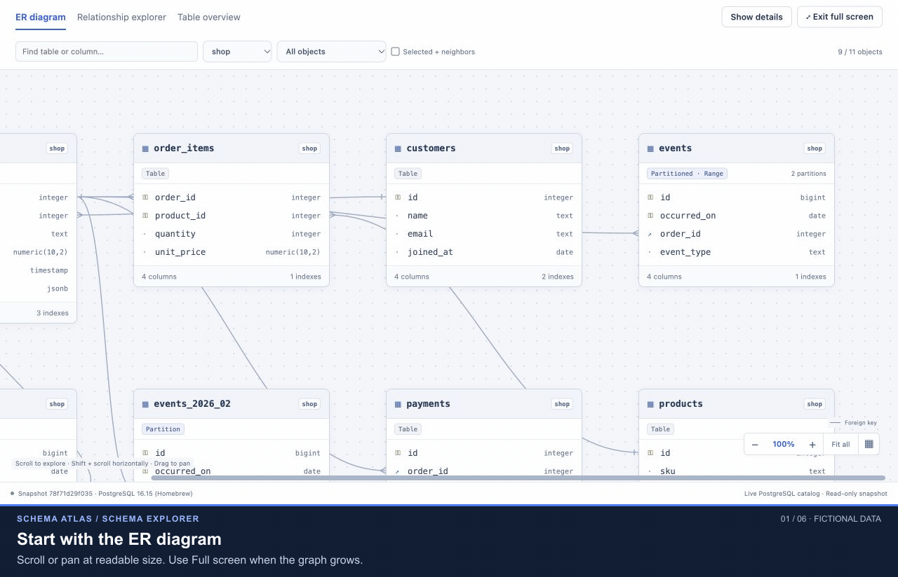
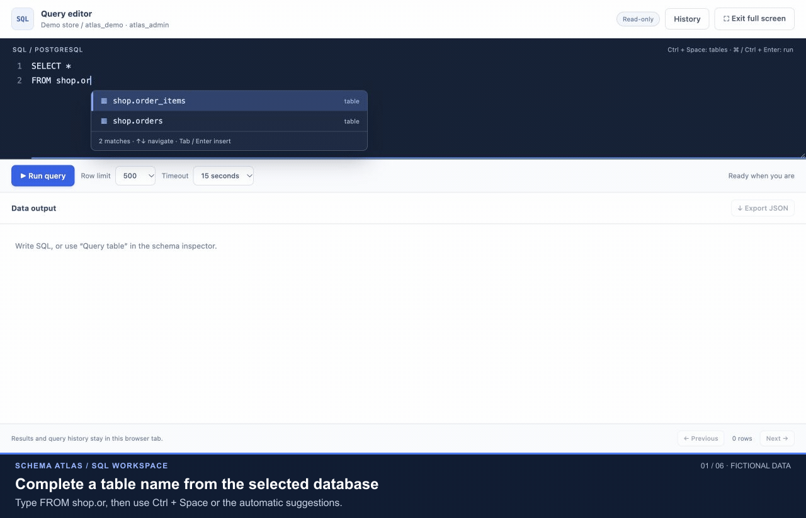
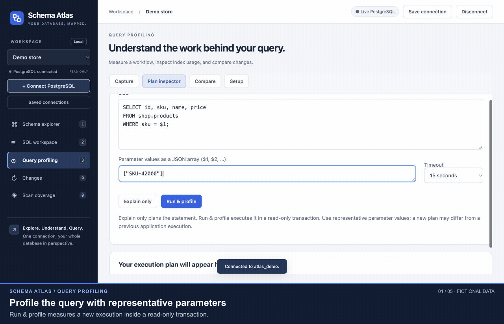
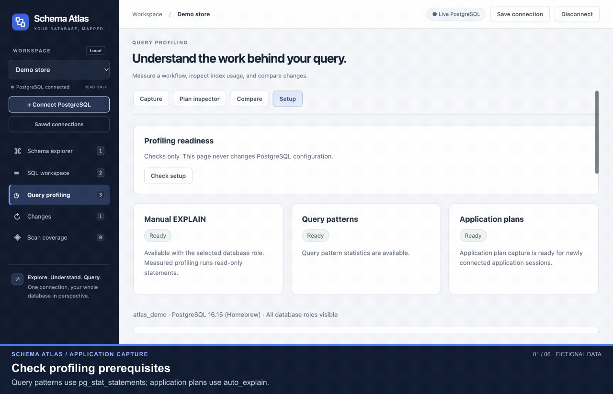

# Schema Atlas

A browser-based PostgreSQL explorer for understanding schemas, running read-only SQL, and investigating query plans. Connect directly to a database; no Phoenix, Elixir, ORM, or application repository is required.

The application has three workspaces:

| Workspace | Use it to |
| --- | --- |
| **Schema explorer** | Browse ER diagrams, follow relationships, inspect table/index/partition metadata, and refresh after schema changes. |
| **SQL workspace** | Run read-only queries with table-name completion, inspect entire result rows, and export results. |
| **Query profiling** | Capture application activity, inspect estimated or measured plans, identify index usage, and compare runs. |

**Status:** under active development. Schema Atlas is the current working name. This is a local application with a Node.js backend, not a static site or a hosted multi-user database service. Feature descriptions below reflect the current implementation; future database administration features are not implied.

[Quick start](#quick-start) · [Requirements](#requirements-and-compatibility) · [Full guide](#contents)

## See it in action

Watch the four short demos below to see how Schema Atlas handles schema exploration, SQL and query profiling. Each animation plays directly in this README. For a still view, use the **Static image** link below each demo.

These are captures of the running application using **fictional shop data**. Step captions were added and pauses shortened. Query timings are illustrative, not benchmarks. [Reproduce the demos or read the text walkthroughs](docs/demos/README.md).

### 1. Explore relationships, indexes and partitions

Move from the full ER diagram to one table's relationships, follow a related table, and inspect index definitions and partition bounds.



[Static image](docs/demos/schema-explorer.png) · 18 seconds · [Schema explorer guide](#use-the-schema-explorer)

### 2. Complete SQL and inspect an entire result row

Select a table-name suggestion, run a read-only query, and open a row to read all its values, including JSON.



[Static image](docs/demos/sql-workspace.png) · 15 seconds · [SQL workspace guide](#use-the-sql-workspace)

### 3. Compare a query before and after adding an index

Save a measured baseline, add an index **outside the tool**, refresh the schema, and profile the same query again. Compare shows the actual change from a sequential scan to an index scan. Manual profiling needs no PostgreSQL extension.



[Static image](docs/demos/index-comparison.png) · 18 seconds · [Comparison guide](#compare-before-and-after)

### 4. Capture application queries and verify executed indexes

Check readiness, capture eight sample application queries, and open a recorded plan without re-running its SQL. This demo uses `pg_stat_statements`, `auto_explain`, and PostgreSQL JSON logging; see the [feature dependencies](#feature-dependencies-and-what-stops-working).



[Static image](docs/demos/application-capture.png) · 19 seconds · [Capture guide](#capture-an-application-workflow)

## Contents

- [See it in action](#see-it-in-action)
- [Quick start](#quick-start)
- [Requirements and compatibility](#requirements-and-compatibility)
- [Feature dependencies and what stops working](#feature-dependencies-and-what-stops-working)
- [Connect and save databases](#connect-and-save-databases)
- [Use the schema explorer](#use-the-schema-explorer)
- [Use the SQL workspace](#use-the-sql-workspace)
- [Configure PostgreSQL profiling](#configure-postgresql-profiling)
- [Capture an application workflow](#capture-an-application-workflow)
- [Inspect and interpret a plan](#inspect-and-interpret-a-plan)
- [Compare before and after](#compare-before-and-after)
- [Troubleshooting](#troubleshooting)
- [Limits and data retention](#limits-and-data-retention)
- [Access from another laptop](#access-from-another-laptop)
- [Architecture and code map](#architecture-and-code-map)
- [Development and verification](#development-and-verification)
- [Current boundaries](#current-boundaries)

## Quick start

From the project directory after downloading or cloning the repository:

```sh
npm ci
npm start
```

Open [http://127.0.0.1:8787/](http://127.0.0.1:8787/), click **Connect PostgreSQL**, and enter the connection details. Stop the app with **Ctrl+C** in its terminal.

To use another port:

```sh
npm start -- --port 8788
```

The server binds to `127.0.0.1`; supported ports are 1024–65535. There is no frontend build step. Reload the browser after frontend changes; restart the Node.js process after backend changes. Saved connections remain available after restarting the app.

**Start without installing any PostgreSQL extension.** Schema exploration, metadata, SQL queries, and manual query profiling work without one. Enable the additional PostgreSQL components only when you want to capture application activity.

## Requirements and compatibility

| Component | Requirement / current verification |
| --- | --- |
| Application host | Node.js **22+**, npm, and network access to the PostgreSQL server. |
| Browser | A modern JavaScript-enabled browser. Laptop layouts were checked at 1024 and 1280 pixels wide. |
| PostgreSQL reader | The reader accepts PostgreSQL **12+**. The current integration suite was exercised on **16.15**; this is not a claim that every accepted major version has been tested. |
| Automatic application-plan capture | PostgreSQL **15+** because this implementation reads PostgreSQL JSON logs. The setup example below targets **16** and identifies the 16-only setting. |
| Saved credentials | An available OS credential store on the application host: macOS Keychain, Windows Credential Manager, or persistent Linux Secret Service. Native storage was tested on macOS; Windows/Linux behavior remains unverified. |
| Remote connections | Verified TLS, or an existing SSH tunnel terminating on the application host. |
| Optional repository reader | Elixir 1.17+/OTP 27+ for `--repo` / `--demo` only. |
| Full development test suite | PostgreSQL server binaries and `pg_config`, OpenSSL, and Elixir/OTP, in addition to Node.js. See [verification](#development-and-verification). |

A PostgreSQL server installation is **not** required on the application host when connecting to an existing remote database. The backend must remain running while the browser uses the tool.

## Feature dependencies and what stops working

Dependencies apply to the **selected database connection**. A missing profiling capability does not disable the schema or SQL workspaces.

| Feature or detail | Required PostgreSQL capability | If missing or disabled |
| --- | --- | --- |
| ER diagram, table overview, metadata, refresh | Successful connection, readable catalogs, and `USAGE` on the relevant schemas | Inaccessible schemas are omitted; a failed scan reports an error and retains the previous successful snapshot. No extension is required. |
| ER relationship lines | Actual foreign-key constraints in PostgreSQL | Tables still appear, but relationships defined only in application code or column naming conventions are not inferred. |
| Partition status and bounds | PostgreSQL partition metadata | Ordinary tables show **Partitioned: No**. There is no extension to enable; partitioning is a property of the table. |
| SQL results and measured manual plans | Appropriate object privileges, including `SELECT` for queried tables | The statement fails with a permission error. Seeing table metadata does not grant access to its rows. |
| Manual **Explain only**, **Run & profile**, and plan comparison | PostgreSQL's built-in `EXPLAIN`; a supported statement and its required privileges | No `pg_stat_statements`, `auto_explain`, or JSON logging is needed. Comparison needs two retained plans. |
| Capture **Query patterns**: calls, execution time, rows, buffers | `pg_stat_statements` preloaded and its extension installed in the selected database; statement tracking active | No workload-pattern list. Manual plans still work; captured application plans can work independently. |
| Statistics for queries run by other database roles | Superuser or effective `pg_read_all_stats` privileges | The app restricts the workload list to the connected role's queries. Your application's queries may be absent if it uses another role. |
| Capture **Application plans** | PostgreSQL 15+, active JSON log, `logging_collector`, `jsonlog`, `auto_explain` loaded in application sessions, JSON plan format, an enabled logging threshold, and log-reading privileges | No automatic application plans or evidence of their actual index usage. Statistics can still show workload activity. |
| Actual rows, loops, and executed-node index evidence in captured plans | `auto_explain.log_analyze = on` | Logged plans remain estimates; an index appearing in an estimated plan is not proof that its node executed. |
| Buffer metrics in captured plans | Both `auto_explain.log_analyze` and `auto_explain.log_buffers` enabled | Captured-plan buffer metrics are unavailable. Workload-statistics buffers and manual measured-plan buffers can still be available. |
| Per-node times in captured plans | `auto_explain.log_analyze` and `auto_explain.log_timing` enabled | Node timing shows **—**. With timing off, captured statement duration and measured rows/buffers can still be available. |
| New settings taking effect in your application | New database connections after changing session/database defaults | Existing pool connections can continue using their old settings and produce no plans. Reconnect the application. |
| Saved-connection persistence | OS credential store, private app storage, and this browser's persistent access cookie | Saving/restoring may be unavailable; temporary connections remain usable. This dependency is outside PostgreSQL. |

**Capture can start when either query statistics or application plans are available.** With neither available, enable one in PostgreSQL or use the manual Plan inspector.

These settings are **not required for the current UI**:

- `track_io_timing`: block **counts** work without it. The app does not currently display PostgreSQL I/O timing metrics.
- `pg_stat_statements.track_planning`: workload capture uses execution counters. Manual measured plans obtain planning time directly from `EXPLAIN`.
- `auto_explain.log_wal` and `auto_explain.log_triggers`: their extra fields are not presented by the current plan viewer.
- `auto_explain.log_settings` and `auto_explain.log_verbose`: optional extra context. Recorded non-default planner settings and schema-qualified relations help interpretation when available.

**Ready is a capability check, not proof of complete coverage.** Setup checks the tool's new database sessions and log accessibility. It does not verify the settings in every application pool connection, that tracking is enabled in every session, or that every query passes the configured threshold/sample rate. Confirm readiness with a short capture of a known query.

## Connect and save databases

1. Click **Connect PostgreSQL**.
2. Enter **Host**, **Port**, **Database**, **Username**, and **Password**. Add a connection name if you want a recognizable dropdown label.
3. Choose the connection security mode:
   - **TLS · Verify server certificate** for a remote database. Supply its CA certificate if the system trust store does not recognize it.
   - **Localhost / SSH tunnel · No TLS** for a loopback destination or an existing tunnel. The backend rejects this mode for non-loopback destinations.
4. Leave **Save this connection and password** checked to retain it, or uncheck it for a temporary connection.
5. Click **Connect & explore**. Switch databases using the sidebar dropdown.

The destination is reached **from the machine running Node.js**, not from the laptop displaying the browser. A database called `localhost` on a remote application host means that host's database.

Use a regular database role with the permissions needed for your work. On the tested PostgreSQL configuration, catalog inspection does not require table `SELECT` privileges, but SQL execution does. Row-level security remains effective for the connected role. Managed services can impose additional restrictions.

### How saved connections behave

- Up to **20 saved profiles** and **four active connections** per browser session are supported.
- The last selected saved connection reopens after a page reload or app restart. A temporary connection does not survive an app restart.
- **Disconnect** clears the active connection and its automatic reconnect selection, while keeping its saved profile.
- **Saved connections → Forget → Confirm forget** removes a saved profile. It does not delete the database or immediately close an already active connection.
- **Save connection** in the top bar saves a temporary connection. To update credentials, connect again to the same host, port, database, and username with saving enabled.
- Use the same browser and hostname. `localhost` and `127.0.0.1` have separate browser cookies. Incognito expiry or clearing cookies loses access to that browser's saved profiles. There is no cross-browser sharing or recovery workflow yet.

Profiles are encrypted with AES-256-GCM. The encryption key is stored in the host's OS credential store; the browser receives a private access cookie, not the database password. The encrypted files are outside the repository:

| Host OS | Default profile directory |
| --- | --- |
| macOS | `~/Library/Application Support/Schema Atlas/` |
| Other platforms | `~/.schema-atlas/` |

Run one app process per profile-storage directory. An unavailable key store or invalid ciphertext does not trigger a plaintext fallback. See [SECURITY.md](SECURITY.md) for the storage and connection boundaries.

## Use the schema explorer

### Choose a view

| View | How to use it | How to read it |
| --- | --- | --- |
| **ER diagram** | Click a table, pan or scroll, filter by schema/partition status, and use **Selected + neighbors** to focus. | Cards summarize columns and keys; lines represent catalog foreign keys. A card may show only some columns; the inspector shows the full metadata. |
| **Relationship explorer** | Find a table and browse **References**, **Referenced by**, and self references. Click a related table to follow it; use **Back** to retrace your path. | References are outgoing foreign keys; Referenced by are incoming foreign keys. Cards show column mappings, cardinality and constraint details. |
| **Table overview** | Browse tables in a compact list and select an object for inspection. | Useful when you need names, object types and partition status without a diagram. |

For large schemas, start with **Relationship explorer**. It initially shows eight related-table cards per direction, with **Show next** for additional cards. Its relationship filter searches related tables/keys, and it uses the full snapshot even when the ER diagram has separate filters applied.

The diagram starts at a readable **100%**. Scroll vertically, use **Shift + scroll** horizontally, or drag the background. **Ctrl/Cmd + scroll** zooms. **Fit all** shows the entire visible graph; click the zoom percentage or press **0** to restore readable size. Drag table cards to rearrange them; layout positions can be retained as local browser preferences.

**Full screen** expands the workspace inside the browser. **Hide details** gives the diagram more space. **Esc** exits full screen.

### Read table metadata

| Inspector tab | Included details |
| --- | --- |
| **Columns** | Types, nullability, defaults, primary/foreign-key markers, identity/generated properties, enum values, collation and comments. |
| **Indexes** | Primary/unique indexes, access method, indexed expressions/columns, partial predicates, included columns, validity/readiness, tablespace, size and SQL definition. |
| **Relations** | Foreign-key mappings, including composite keys, cardinality, update/delete actions, deferrability and validation. |
| **Details** | Ownership, row/size estimates, storage settings, row security, replica identity, constraints, partition information, triggers, policies, grants and view definitions. |

Partitioned parents and child partitions have distinct badges. Inspect the strategy/key, child bounds and parent information; a nested partition can also be a partitioned parent. Parent size figures do not automatically sum child sizes. Estimated row counts come from PostgreSQL statistics, not a live `COUNT(*)`.

### Refresh, changes and coverage

Apply migrations through your normal workflow, then click **Refresh schema**. Added and modified objects are highlighted; **Changes** compares the current catalog with the previous successful scan for that connection. There is no background polling or historical schema archive. A failed scan retains the previous successful snapshot.

Changes to row estimates and sizes alone do not count as schema changes. Disconnect, session expiry or a backend restart loses the server's schema-comparison baseline.

**Scan coverage** explains the source and its limitations. **Export snapshot** downloads schema metadata as JSON. It excludes passwords, but definitions/comments/role names can still be private information.

## Use the SQL workspace

1. Select a connected database and open **SQL workspace** (shortcut **2**). The editor is disabled until connected.
2. Enter a single statement, or choose a table in the schema inspector and click **Query table** to insert a quoted, schema-qualified query.
3. Click **Run query** or press **Cmd/Ctrl + Enter**. Selected text runs by itself; otherwise the whole editor runs.
4. Read the result grid. Click a row to open **all of its columns and retained values** in a scrollable modal. Use **Esc** to close it.
5. Use **Cancel**, row-limit/timeout controls, **History**, **Export JSON**, and **Full screen** as needed.

Table-name suggestions appear after `FROM`/`JOIN`; **Ctrl + Space** opens completion manually. Use arrows and **Tab/Enter**, or click a suggestion. Suggestions come from the selected catalog and update after refresh or connection changes. This completion belongs to the SQL workspace; the separate profiling editor currently uses plain text.

Results distinguish `NULL` from empty strings and preserve exact numeric strings. Paging shows 100 retained rows at a time; it does not fetch more rows from PostgreSQL. A truncation notice means the displayed row count is not the complete query cardinality. The displayed operation duration includes client/connection work and is different from the server execution time in a plan.

The workspace accepts one read-only `SELECT`, `WITH`, `EXPLAIN`, `SHOW`, `TABLE`, or `VALUES` statement per run. Writes, DDL, multi-statement scripts, and persistent transactions are unavailable. Each operation uses a fresh connection and closes it afterward. Session `SET` changes, temporary objects and prepared statements do not carry across runs. Read-only transactions do not sandbox privileged functions with external side effects; use appropriate database-role privileges.

## Configure PostgreSQL profiling

All examples use fictional names: **`app_dev`** is the database and **`db_admin`** is an existing administrator. Substitute your own names. These are administrative setup steps, performed outside Schema Atlas's read-only editor. The app's **Setup** tab diagnoses configuration; it does not apply changes.

### 1. Inspect the current configuration

Connect with your normal administrative client, for example:

```sh
psql -h 127.0.0.1 -p 5432 -U db_admin -d app_dev -W
```

Inspect the server before changing it:

```sql
SHOW server_version;
SHOW config_file;

SELECT name, setting, context, pending_restart
FROM pg_settings
WHERE name IN (
  'shared_preload_libraries', 'session_preload_libraries',
  'compute_query_id', 'logging_collector', 'log_destination',
  'pg_stat_statements.track', 'auto_explain.log_min_duration',
  'auto_explain.log_format', 'auto_explain.log_analyze',
  'auto_explain.log_buffers', 'auto_explain.log_timing'
)
ORDER BY name;

SELECT extname FROM pg_extension WHERE extname = 'pg_stat_statements';
```

Module-specific settings can be absent until the module is loaded. Record existing values and database/role overrides, and back up any configuration file you edit. Preserve existing preload libraries and log destinations when merging the following examples. Restarting PostgreSQL disconnects clients for **every database on that server**.

### 2. Enable workload statistics

Merge these settings into the active PostgreSQL configuration. This example assumes an initially empty preload list:

```conf
shared_preload_libraries = 'pg_stat_statements'
# PostgreSQL 14+; omit this setting on 12/13.
compute_query_id = auto
pg_stat_statements.track = top
```

If other libraries are present, keep them and append `pg_stat_statements`. Restart PostgreSQL using the service/container manager that owns it. Reloading alone does not apply a changed preload list. Then connect to **each database you want to profile** and run:

```sql
CREATE EXTENSION IF NOT EXISTS pg_stat_statements;
```

The preload is server-wide; extension installation exposes its views in the current database. `track = none` disables collection. On versions with `compute_query_id`, disabling query-ID calculation without an alternative provider prevents tracking. [PostgreSQL statistics extension reference](https://www.postgresql.org/docs/16/pgstatstatements.html).

Check that the view can be queried; use the extension's schema if it was installed outside the current search path:

```sql
SELECT count(*) AS tracked_patterns FROM pg_stat_statements;
```

Superusers or roles with `pg_read_all_stats` privileges can inspect other roles' query text. An administrator can decide whether that extra visibility is appropriate; it is not necessary for manual plans. [PostgreSQL predefined roles](https://www.postgresql.org/docs/16/predefined-roles.html).

### 3. Enable automatic application plans

`auto_explain` is a loadable module, **not a `CREATE EXTENSION auto_explain` step**. If its library or `pg_stat_statements` is unavailable, install the matching optional/contrib modules provided by your PostgreSQL distribution.

For this application's automatic reader, merge these **server-level** settings and restart if the collector was previously off:

```conf
logging_collector = on
log_destination = 'stderr,jsonlog'
```

Preserve other configured destinations. JSON logging requires the collector, and enabling the collector requires a server restart. Logs live on the database server, which may differ from the Schema Atlas host. The reader accesses the active log through PostgreSQL. [PostgreSQL logging configuration](https://www.postgresql.org/docs/16/runtime-config-logging.html).

Apply the following **database-level** defaults for a short local investigation. If the database already has session preload libraries, merge them into the first value:

```sql
ALTER DATABASE app_dev SET session_preload_libraries = 'auto_explain';
ALTER DATABASE app_dev SET auto_explain.log_min_duration = '0ms';
ALTER DATABASE app_dev SET auto_explain.log_format = 'json';
ALTER DATABASE app_dev SET auto_explain.log_analyze = on;
ALTER DATABASE app_dev SET auto_explain.log_buffers = on;
ALTER DATABASE app_dev SET auto_explain.log_timing = off;
ALTER DATABASE app_dev SET auto_explain.sample_rate = 1;
```

On **PostgreSQL 16+**, also disable separate parameter-value logging:

```sql
ALTER DATABASE app_dev SET auto_explain.log_parameter_max_length = 0;
```

Omit that last setting on PostgreSQL 15; it is absent from the [PostgreSQL 15 module reference](https://www.postgresql.org/docs/15/auto-explain.html). SQL literals and expressions in a plan can still reveal values, even with parameter logging disabled.

Optional context for the viewer:

```sql
ALTER DATABASE app_dev SET auto_explain.log_verbose = on;
ALTER DATABASE app_dev SET auto_explain.log_settings = on;
```

**Reconnect your application/pool after changing these defaults.** Database defaults apply to new sessions, and role or session overrides may take precedence. Configure the connection used by Schema Atlas consistently too: its readiness check cannot inspect every existing application session. [Database setting behavior](https://www.postgresql.org/docs/16/sql-alterdatabase.html).

The automatic log reader needs superuser or usable `pg_read_server_files` privileges, plus access to inspect the logging settings. A restricted diagnostic role may also need `pg_read_all_settings` or an administrator's help. These are broad server capabilities; basic schema exploration/manual profiling does not require granting them. Hosted PostgreSQL providers often restrict direct log-file access, so automatic plan capture may remain unavailable there.

A `0ms` threshold and sample rate `1` are useful for a short local reproduction. Higher thresholds/sampling can omit executions. Instrumentation has overhead even when some plans are not logged; disabling per-node timing reduces that overhead. Use server-managed log retention for longer investigations. [PostgreSQL auto_explain reference](https://www.postgresql.org/docs/16/auto-explain.html).

### 4. Verify and stop logging when finished

1. In a **new** administrative session, repeat the settings query above. Confirm the effective settings and resolve any `pending_restart` values.
2. Check `SELECT pg_current_logfile('jsonlog');` returns a path, using a role allowed to call it.
3. In Schema Atlas, open **Query profiling → Setup → Check setup**.
4. Capture a known application action and confirm actual query patterns/plans appear. A configuration badge alone is insufficient.

**Stopping a browser capture does not turn PostgreSQL logging off.** To stop plan logging configured by this example:

```sql
ALTER DATABASE app_dev SET auto_explain.log_min_duration = '-1';
```

Reconnect the application's pool so it adopts the new default. Existing sessions and any stronger role/session overrides must also stop logging. This leaves `pg_stat_statements` and manual profiling usable. To undo setup completely, restore the settings you recorded earlier; remove only libraries/destinations you added. Do not use a blanket `RESET ALL` that would remove unrelated database settings.

## Capture an application workflow

1. Select the database used by your application.
2. Open **Query profiling → Setup** and confirm the capabilities you need.
3. Open **Capture → Start profiling**.
4. Reproduce a small action in your application, such as loading a page or running a background job.
5. Click **Stop profiling** before the 30-minute limit. **Discard session** abandons an interval you no longer need.
6. Read **Query patterns** and **Captured application plans**. Filter by SQL/role text; captured plans also match application-name text. Sort workload patterns by total time, count, average time or blocks read.

### Read the workload list

The list is a difference between two cumulative-statistics snapshots, scoped to the selected database and visible roles. It includes other work happening in that database during the interval. It is not an HTTP request trace or a timestamped list of every execution.

| Column | Meaning in this capture window |
| --- | --- |
| Query pattern / role | Representative normalized SQL and the database role. Different literal values can share one pattern. |
| Calls | Increase in execution count. |
| Total | Increase in cumulative execution time. A frequently executed query can dominate despite a small average. |
| Average | Captured total execution time divided by captured calls. This is not P95 or the lifetime average. |
| Rows | Increase in rows retrieved or affected, not rows examined by every plan node. |
| Buffer hits | Increase in accesses served from PostgreSQL's shared buffers. |
| Blocks read | Increase in shared blocks read into buffers. This is a block count, not elapsed I/O time or proof of physical disk access. |

**Inspect** copies a pattern to the manual Plan inspector. It does not recover the application's parameter values or original execution plan. Normalization can add placeholders for constants such as `LIMIT`; supply every required value before re-running supported SQL. Truncated patterns require the complete statement. DDL/write patterns may appear in captures, but the manual editor remains read-only.

### Read captured application plans

Each plan belongs to a logged application execution. **View captured plan** opens that record without running its SQL again; captured write statements can therefore be inspected too. The list shows its reported duration and selected/executed indexes. An unnamed client appears as **Unknown application**.

The workload list and captured-plan list are separate evidence sources. The current app does not guarantee a one-to-one join between an aggregate pattern and a logged execution. Filtering helps find relevant records without claiming an exact mapping.

Read every incompleteness message: counter resets/evictions, log rotation, truncated records, and collection limits can invalidate or omit part of the interval. A query crossing a capture boundary may not align exactly between statistics and logs. Tool-generated profiling queries are filtered out; application background work is not.

## Inspect and interpret a plan

### Run a manual inspection

1. Open **Query profiling → Plan inspector**.
2. Enter a supported read-only statement **without adding `EXPLAIN` yourself**.
3. Enter parameter values as a JSON array in `$1`, `$2`, … order. Use `[]` when there are no placeholders.
4. Choose **Explain only** for planner estimates, or **Run & profile** to execute the statement in a read-only transaction and measure its plan.
5. Select a plan from **Plans in this tab**. Expand **Statement for this plan** to verify the SQL/parameter context before interpreting it.
6. Expand plan nodes and choose **Inspect table / index** to view catalog definitions. **Open full table metadata** returns to the schema inspector.

This example requires no user table and is useful for a first check:

```sql
SELECT n
FROM generate_series(1, 100) AS sample(n)
WHERE n > $1::integer;
```

Parameter values:

```json
[90]
```

A measured run should produce ten output rows; no table index is expected for `generate_series`. For an index investigation, replace it with a real query against your application's tables and representative parameters.

Parameters currently accept JSON strings, numbers, booleans and `null`, not nested JSON arrays/objects. Use a string plus an explicit SQL cast for PostgreSQL JSON/array/date values when needed. Supply very large integers as strings with a suitable cast to avoid JavaScript number rounding.

### Distinguish plan sources

| Label | What it proves |
| --- | --- |
| **Estimated now** | The plan selected for the supplied statement/parameters now. It has no measured node execution evidence. |
| **Measured now** | A fresh execution performed by **Run & profile**, including available actual rows, time and buffer metrics. |
| **Captured application execution** | An application plan with actual measurements from logging. Node loops identify which parts executed. |
| **Captured application plan** | A logged plan without actual node measurements. It shows the chosen structure, not measured node activity. |

A fresh manual execution may differ from the application's prepared/generic plan, parameters, session settings, cache state or data. Use a captured application execution when the question is what the application actually did. `EXPLAIN ANALYZE` runs the statement and introduces measurement overhead. [PostgreSQL EXPLAIN reference](https://www.postgresql.org/docs/16/sql-explain.html).

### Read the tree and metrics

| Item | Interpretation |
| --- | --- |
| Execution / Planning | Server-reported durations when provided. Missing planning time in an application log is shown as **—**. |
| Actual / estimated rows | Rows produced by the node versus the planner's estimate; examine large differences. |
| Loops | Number of node executions. Actual rows/time are per-loop averages; zero loops means the node did not execute. |
| Inclusive node time | Includes child work. Do not add times across the tree. |
| Shared buffer hits / blocks read | Buffer activity; parent counters include child work. Do not sum them across all nodes. |
| Temporary blocks written / disk sort | Evidence of temporary disk work; investigate volume, sorts and joins before attributing it to indexes. |
| Estimated cost | Planner cost units, not milliseconds. |
| **—** | Measurement unavailable. It is different from a measured zero. |

Start with the scan for the table you care about, then read its conditions and parent join/sort nodes. [PostgreSQL's plan-reading guide](https://www.postgresql.org/docs/16/using-explain.html) explains the underlying execution model.

| Plan detail | How it helps answer the index question |
| --- | --- |
| `Index Scan` | Names the selected index and its index condition. Check loops for actual execution. |
| `Index Only Scan` | Uses an index-only access path; nonzero heap fetches show that table visibility checks still occurred. |
| `Bitmap Index Scan` / `Bitmap Heap Scan` | The index participates in a bitmap access path, even though a heap scan also appears. |
| `Seq Scan` | PostgreSQL chose a sequential scan. This can be appropriate for small tables or predicates returning much of the table. |
| `Index Cond` versus `Filter` | An index condition narrows index access; a filter can discard rows after access. An index's presence alone does not mean every predicate uses it. |
| **Not executed** / zero loops | A displayed index in that branch is not evidence of use in this run. |
| Table & index context | Compare index columns/order, expressions, partial predicate, included columns and validity with the query. Definitions are metadata, not automatic recommendations. |

The current **Worth investigating** messages flag approximately 10× row-estimate differences, large filter discards, and temporary disk work. They are clues, not a diagnosis or automatic index advice. Small local datasets may choose very different plans from production-sized data. The app does not calculate a universal “good index” score.

## Compare before and after

1. Profile a query and click **Save as baseline**.
2. Change your SQL or apply an index/migration through your normal development workflow, outside this tool.
3. Refresh the schema explorer if table/index metadata changed.
4. Profile again with the same representative parameters and comparable data/settings.
5. Open **Compare** and choose the baseline and comparison plans.
6. Read time/buffer/row deltas alongside the scan and index lists. Repeat measured runs before concluding that a change helped.

The app retains up to eight plans in each connection's tab history. A saved baseline is retained when that history limit is reached, but it is still temporary browser memory and clears on reload/disconnect.

A positive delta means the comparison value increased; a negative delta means it decreased. A missing metric produces no numeric delta. A zero baseline has no percentage comparison. Estimated-plan comparisons cannot establish a runtime improvement. Mixed application/manual sources can have different instrumentation; differing SQL or unknown/different parameters are also called out.

## Troubleshooting

| Symptom | Check / next step |
| --- | --- |
| Cannot connect | Verify host/port/database, credentials, server network access and PostgreSQL client authentication. Remember that the backend host makes the connection. |
| Remote connection rejected | Use verified TLS with the correct CA/hostname, or connect through an existing local SSH tunnel. |
| Missing tables | Check the selected database and schema `USAGE`, refresh the catalog, and review filters. System schemas are intentionally omitted. |
| Missing relationship lines | Check for actual PostgreSQL foreign keys. Column names such as `customer_id` alone are insufficient. |
| SQL permission error despite visible metadata | Grant only the needed object privileges through the normal admin workflow; catalog visibility and row access differ. |
| Saved profiles disappeared | Check browser, hostname, incognito/cookie changes and the host's credential store. Changing ports on the same hostname does not isolate cookies. |
| Save disabled or key-store error | Unlock/configure the host credential store. Use a temporary connection while resolving it; the app does not fall back to plaintext. |
| Query patterns need setup | Check preload plus restart, extension installation in this database, query-ID calculation, tracking, and privileges. |
| Query patterns are empty although Setup says Ready | Reproduce a known query, allow it to finish, check role visibility and `pg_stat_statements.track`, then capture again. The readiness probe does not prove collection is active everywhere. |
| Statistics exist but no captured plans | Statistics do not contain plans. Check JSON logging, module loading, threshold/sample rate, log permissions and new application connections. |
| Application uses `LOAD auto_explain` only | The current readiness gate looks for configured shared/session preloading visible to the tool. Use the documented preload setup for automatic capture. |
| Captured plans lack actual rows or buffers | Check `log_analyze` and `log_buffers` in the application's effective settings. Timing off alone does not remove row/buffer measurements. |
| Node times are **—** | Expected with `auto_explain.log_timing = off`; statement duration and other measurements may still be available. |
| A pattern has more placeholders than the original query | Statistics normalize literal constants. Supply the full set of parameter values or use the original application SQL. |
| Plan index context cannot find a relation | Refresh after DDL. System/temporary/inaccessible relations may be absent from the schema snapshot. Without a recorded schema, multiple matches may be shown. |
| Capture expired | Discard the interval and start a shorter session. Captures have a 30-minute limit. |
| Rotation, reset, eviction or limit warning | Treat the result as incomplete. Reproduce a shorter window after the event; the tool does not stitch old logs together or reset counters. |
| Query/result/plan too large | Narrow selected columns, shorten SQL/capture duration, or inspect a smaller query. The app enforces response and plan bounds. |
| “Operation already running” / too many requests | Finish/cancel the active operation and wait for the request budget to recover. SQL and profiling share concurrency limits. |
| Browser is unreachable | Confirm the Node.js process is running on the chosen port. Use `--port` if another process already owns it. |

## Limits and data retention

| Area | Current bounds |
| --- | --- |
| Schema snapshot | 2,000 objects; 50,000 columns; 16 MB aggregate catalog data; 25-second scan deadline; additional category-specific caps. |
| Metadata display | Comments: 4,096 characters; expressions: 8,000; SQL definitions: 12,000. Changes beyond display limits may not be detected. |
| SQL workspace | 32,000 SQL bytes; up to 1,000 rows and 200 columns; 2 MiB retained result data; 8 MiB protocol response cap. |
| SQL controls | UI row limits 100/500/1,000; statement timeouts 5/15/20 seconds. The backend accepts 100–20,000 ms and adds a connection deadline. |
| Profiling input | Up to 64 scalar parameters, 16,000 JSON bytes total, 4,000 characters per string. The UI limits SQL to 31,000 characters; the backend byte limit includes the generated EXPLAIN wrapper. |
| Capture | 30 minutes; first 500 statement patterns by identifier; 2,000 displayed SQL characters per pattern; first 512 KiB of the log interval and 2,500 records; at most 100 parsed application plans. These are limits, not a claim to retain the top 500 busiest queries. |
| Plan | At most 1,000 nodes and 40 levels; text fields are capped at 8,192 characters; bounded findings/settings lists. |
| Browser history | 20 SQL queries per connection; eight plans per connection, plus the current capture's plan list. |
| Connection/session | 20 saved profiles; four active connections; 30-minute idle / eight-hour absolute active-session lifetime. |
| Work budgets | One SQL/profiling operation per browser session, two globally; 30 attempts/minute/session and 60/minute/server. HTTP/catalog/connection operations also have separate budgets. |

| Data | Where it lives / when it disappears |
| --- | --- |
| Saved connection settings and passwords | Encrypted host storage until forgotten; the encryption key remains in the OS credential store. |
| Saved-profile access identity | Persistent HttpOnly browser cookie, renewed for one year when the app opens. |
| Active credentials and schema-change baseline | Server memory; released on disconnect, expiry or server shutdown. |
| SQL drafts, history, results, profiling results and baselines | Browser-tab memory; cleared on reload/disconnect. The app does not write them to localStorage or a server results archive. |
| Active capture start snapshot/cursor | Server session memory; usable for up to 30 minutes. Reload can recover an active cursor within that session, but backend restart cannot. |
| Diagram positions | Optional local browser preferences. |
| Exported JSON | Files downloaded explicitly by the user; no automatic deletion. |
| PostgreSQL statistics/logs | Managed independently by PostgreSQL. Closing the browser, discarding a capture or disconnecting does not erase them or disable logging. |

## Access from another laptop

Run the backend on a machine that can reach PostgreSQL. Use existing authenticated SSH access to forward its loopback port:

```sh
ssh -N -L 8787:127.0.0.1:8787 your-user@your-server
```

Open [http://127.0.0.1:8787/](http://127.0.0.1:8787/) on the laptop. Its browser accesses the remote backend through the tunnel. Saved-profile access is browser-specific, so a different laptop/browser does not automatically inherit another browser's saved connections.

Publishing the source on GitHub does not host the backend or database. GitHub Pages cannot run this Node.js/PostgreSQL service. Public multi-user deployment needs a separate authentication/deployment design; this app currently relies on loopback access and the trusted host OS account.

## Architecture and code map

```text
Browser
  └─ same-origin HTTP + session/CSRF checks
       └─ Node.js service, bound to loopback
            ├─ PostgreSQL catalogs → schema snapshot → diagram/metadata
            ├─ read-only SQL / JSON EXPLAIN → results and plans
            ├─ statistics snapshots + active JSON log → capture results
            └─ encrypted profiles ↔ OS credential-store key
```

Database work uses fresh, bounded connections rather than an idle connection pool. The app has no third-party browser scripts, remote fonts or telemetry. Catalog text, SQL and results render as text rather than executable HTML. Read [SECURITY.md](SECURITY.md) for the detailed trust boundaries, transport rules and request controls.

| File | Responsibility |
| --- | --- |
| [server.mjs](server.mjs) | Static assets, loopback HTTP, sessions, connection ownership, CSRF, budgets and API routes. |
| [lib/postgres.mjs](lib/postgres.mjs) | Connection validation, TLS/address handling, catalog inspection and schema normalization. |
| [lib/profiles.mjs](lib/profiles.mjs) | Encrypted saved profiles, OS key access and persistent browser ownership. |
| [lib/query.mjs](lib/query.mjs) | Single-statement read-only queries, bounds, deadlines and cancellation. |
| [lib/profiling.mjs](lib/profiling.mjs) | Diagnostics, parameterized EXPLAIN, statistics deltas and scoped JSON-log reading. |
| [web/app.js](web/app.js) | Connections, schema views, metadata and workspace navigation. |
| [web/query.js](web/query.js) | SQL editor, table completion, results, row modal and history. |
| [web/profiling.js](web/profiling.js) | Capture, Plan inspector, Compare and Setup interfaces. |
| [web/plan.js](web/plan.js) | Bounded plan projection, findings and comparison metrics. |
| [lib/repository.mjs](lib/repository.mjs), [lib/schema.mjs](lib/schema.mjs), [lib/parse.exs](lib/parse.exs) | Optional static Ecto reader and shared schema-diff logic. |
| [tests](tests) | Unit, HTTP and disposable PostgreSQL integration tests. |
| [sbom.json](sbom.json) | Recorded dependency inventory. |

The frontend is buildless HTML/CSS/JavaScript. Dependencies are pinned in `package-lock.json`. This repository is configured as a private npm package; no npm publishing workflow is provided. A project license file has not yet been added.

## Development and verification

Run commands from the repository root:

```sh
npm ci
npm test
npm audit --omit=dev
```

Focused suites:

```sh
npm run test:postgres
node --test tests/query.integration.test.mjs
node --test tests/profiling.test.mjs
node --test tests/profiles.test.mjs
node --test tests/autocomplete.test.mjs
node --test tests/server.test.mjs
```

To include the disposable native OS credential-store test on a configured host:

```sh
ATLAS_TEST_KEYCHAIN=1 npm test
```

That environment-variable syntax is for POSIX shells. In PowerShell, set `$env:ATLAS_TEST_KEYCHAIN = '1'` before running `npm test`.

The complete suite needs `pg_config` on `PATH`, matching PostgreSQL server binaries/modules, OpenSSL, and Elixir/OTP for the legacy parser tests. Fixtures create private temporary clusters with generated credentials, apply test-only schema/index changes, and clean them up. Run as a normal OS user capable of running `initdb`. These tests do not require production credentials or target an existing application database. Some older integration suites skip when PostgreSQL binaries are absent; profiling tests require them. Inspect skips/failures rather than treating missing tooling as a full pass.

| Test area | Coverage |
| --- | --- |
| Schema/catalog | Metadata, composite keys, partitions, least-privilege catalog access, DDL refresh and failed-refresh retention. |
| SQL | Exact values, NULLs, permissions/RLS, read-only and single-statement enforcement, cancellation, deadlines and result bounds. |
| Profiling | Real statement statistics and auto_explain logs, workflow counts, index use before/after fixture index creation, estimated/measured distinctions, parameter binding, log filtering/limits/rotation, resets and cancellation. |
| HTTP | Host/origin checks, CSRF, connection ownership, session expiry and request/concurrency budgets. |
| Saved profiles | Encryption, tampering, ownership, private permissions, persistence/reconnect and missing-key failure. |
| Completion and legacy reader | SQL completion contexts/catalog updates; static migration/schema interpretation and unsupported-source reporting. |

**Recorded validation, 2026-10-13:** 58 tests passed with no skips on macOS/PostgreSQL 16.15, including the native credential-store test. Dependency auditing reported zero known vulnerabilities at that time. Browser checks covered live application capture, manual plans, index metadata, comparison, cancellation, disconnected states, existing SQL/whole-row details, and laptop layouts. These are recorded results, not a substitute for rerunning checks after changes. Snyk Code was unavailable because its executable was not installed; source scanning remains unverified.

**Documentation verification, 2026-10-14:** the configuration and SQL blocks in this README were applied to a disposable PostgreSQL 16 cluster. The smoke query produced ten measured rows without extensions; after setup, a capture recorded two application calls and two measured plans. The stop-logging command disabled application-plan capture on a new connection while keeping statement statistics available. Local file links, section anchors, code fences, npm script names and CLI help were checked. The full application suite was not rerun for this documentation-only update.

For optional manual fixture checks:

- `node tests/helpers/demo-preview.mjs` starts an isolated fictional shop database/app at port 8791 for the [product walkthroughs](docs/demos/README.md). Commands: `add-index`, `workload`, `mutate`, and `stop`.
- `node tests/helpers/preview.mjs` creates a disposable database and prints a private connection-file path. Enter `large` to create a large diagram, `mutate` to exercise schema refresh, and `stop` to clean up. Start the app separately.
- `node tests/helpers/persistence-preview.mjs` starts a disposable database/app at port 8789. Enter `restart` to test reconnect after app restart, and `stop` to clean up the database, profile files and test key.

For the legacy repository-only demo:

```sh
npm start -- --demo
```

Or inspect a local Ecto repository:

```sh
npm start -- --repo /path/to/your/phoenix-app
```

Only these optional modes require Elixir. They parse source without executing repository code; they do not prove which migrations were applied. **Scan coverage** identifies static-reader limitations. A repository-only source cannot query a database or use live profiling.

## Current boundaries

- PostgreSQL only; no other database engine adapters.
- Read-only SQL and manual profiling; no row editing, DDL administration, migration execution, query tabs or persistent SQL sessions.
- Catalog relationships only; no application-only relationship inference, cross-database graph or view-dependency graph.
- Refresh-based schema snapshots; no background change monitoring or durable schema-history timeline.
- Capture windows, not continuous monitoring, distributed tracing or per-request correlation.
- No P95 latency, per-query CPU/total-memory accounting, or automatic index recommendations/creation.
- No durable profiling history, imported plan files, full raw-plan export, or arbitrary PostgreSQL log-file uploads.
- No cross-browser saved-profile sharing, application user accounts or public multi-user hosting.

Configuration examples and walkthroughs use fictional database names. Schema snapshots, exported rows, screenshots and PostgreSQL logs may contain real project data; public documentation should use sanitized examples.
